 

 

---

## 👨‍💻 About Me

- 🎓 Final-year engineering student in **Artificial Intelligence and Data Science**.
- 🤖 Interested in **Generative AI, LLMs, AI Agents, and RAG**.
- 💻 Building applications using **Python, Java, React, and modern backend technologies**.
- 🔗 Exploring REST APIs, database integration, and workflow automation.
- 🏆 **Smart India Hackathon 2025 Grand Finale Finalist** – Team CodeBlazers.
- 🌱 Continuously learning and building production-oriented software solutions.

 

---

## 🛠️ Tech Stack

### Programming Languages

### Frontend Development

### Backend & Databases

### AI, LLMs & Automation

### Developer Tools

---

## 🚀 Featured Projects

### 1. AI-Driven Healthcare Disease Chatbot – SIH 2025

🏆 **Smart India Hackathon 2025 Grand Finale Finalist**

Worked on backend development as part of Team CodeBlazers.

- API design and database integration.
- AI logic and workflow automation using n8n.
- Multilingual healthcare information access.
- Preventive healthcare for rural and semi-urban communities.

### 2. Cura_Bot – Multi-Agent Healthcare AI

A healthcare assistant designed to support symptom triage and healthcare coordination.

- Multi-agent architecture for healthcare queries.
- Retrieval-Augmented Generation using medical knowledge sources.
- Python backend and Supabase integration.
- Safety-focused medical guidance and escalation workflows.

### 3. PillCareX – Medication Adherence & Side-Effect Assistant

A healthcare application concept designed to help users manage medication schedules and understand medicine-related information.

- Medication schedule and adherence tracking.
- Prescription information extraction and normalization.
- RAG-based medicine information and side-effect guidance.

### 4. Capacity Connect – Digital Learning Portal

A centralized digital capacity-building and learning management portal.

- Role-based access for trainees, trainers, and administrators.
- Learning modules and MCQ assessments.
- Evidence checking and progress dashboards.

---

## 📊 GitHub Statistics

 

---

## 🟩 GitHub Contribution Activity

  <b>Consistency builds progress.</b>

<!-- BEGIN ACTIVITY-GRAPH -->
<picture>
  <source media="(max-width: 767px)" srcset="activity-graph-mobile.svg">
  
</picture>
<!-- END ACTIVITY-GRAPH -->

---

## 🎯 Current Focus

- 🤖 Building AI-powered applications with LLMs and agentic workflows.
- ⚙️ Improving backend engineering and REST API development.
- 🌐 Developing full-stack applications with React and Python/Node.js.
- 🧠 Practising Data Structures and Algorithms.
- 🚀 Learning deployment and production-level software engineering.

---

## 🤝 Let's Connect

I'm interested in collaborating on **AI/GenAI, healthcare technology, developer tools, and full-stack projects**.

---

 

